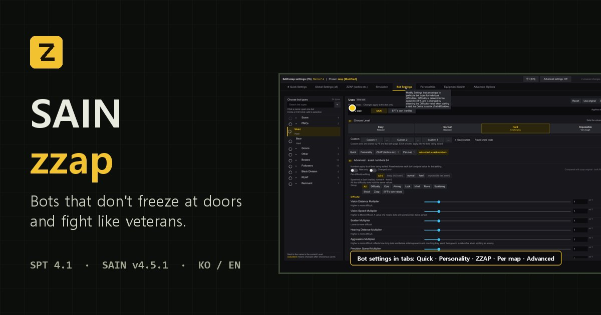

  
  

  

<h2 align="center">📖 <a href="https://danyhappy564-cmyk.github.io/SAIN-zzap--Bootleg-/?lang=en">Everything is explained on the project site →</a></h2>

Tactics · door-stuck fixes · settings screens · presets · compatible mods · bug reports — one page, with GIFs.

  
  

---

### ⚠️ IMPORTANT NOTICE / DISCLAIMER

- **Original Author:** Solarint
- **Original Repository:** SAIN - Solarint's AI Modifications
- **Original Link:** https://github.com/Solarint/SAIN
- **License:** See upstream repository
- **This Port By:** R_F (danyhappy564-cmyk) — unofficial, AI-assisted port. Not affiliated with or endorsed by the original author.

1. **Reflection & Take-Downs:** I deeply reflect on the ECOT incident. As an AI-assisted "vibe coder," I will immediately delete files if the original authors ask.
2. **No Re-Distribution:** These ported builds are unverified, temporary fixes. Please do NOT re-upload or share them anywhere else.
3. **Do Not Pester Original Authors:** Never report bugs or pester original modders regarding issues from my unofficial ports.
4. **Full Credit & Respect:** I will always credit original creators on GitHub and prioritize their decisions above all else.
5. **Support Original Creators:** Instead of using my ports, please visit the original authors' Forge pages to leave kind words or tips.

---

## Changelog

The full changelog (261 entries) is in the [`changelog/`](changelog/) folder, 10 per file (higher number = newer, latest: [`CHANGELOG-027.md`](changelog/CHANGELOG-027.md)). Per-release summaries: [Releases](../../releases).

## SAIN zzap

**Original author · Original project (credits)**
- **Solarint** — SAIN (Solarint's AI Modifications) · https://github.com/Solarint/SAIN
- 4.x maintenance: **ArchangelWTF** · https://github.com/ArchangelWTF/SAIN
- Code and values taken from or modelled on:
  - **bmpq (tarkin)** — doordash · https://github.com/bmpq/spt-doordash · Forge https://sp-mod.com/mod/2214/doordash (MIT — as stated on its Forge page; the repository has no license file)
  - **maschine34675** — DualSideDoorBreach 2.0.2 · https://github.com/maschine34675/DualSideDoorBreach (MIT, Copyright (c) 2026 maschine34675)
  - **Chazut** — ORBIT · https://github.com/Chazut/ORBIT (MIT) — three door-stuck fixes (door-state watchdog, 0.25x slow-down near doors, horizontal-only stillness check) modelled on ORBIT's code, rewritten for SAIN's own door handling and adjusted since then from in-game problems (1.2 s watchdog for every door on the map, urgent moves slow only for shut doors from 1.5 m, and more — full history and current state in [`changelog/FIXES.md` section 16](changelog/FIXES.md) (Korean)). The zzap presets use ORBIT's recommended personality mix and extraction settings
  - **harmony** — TwitchPlayers · https://github.com/harmonyzt/TwitchPlayers · Forge https://sp-mod.com/mod/1895/sain-twitch-players (MIT — as stated on its Forge page; the repository has no license file) — the zzap presets' shooting, aiming and reaction values come from the TwitchPlayers (hardcore) preset

An unofficial fork of SAIN (the mod that replaces EFT's bot AI). It ① fixes **bots getting stuck at doors**, ② adds **tactics modelled on veteran play**, and ③ ships ready-to-use **zzap presets**.

**SPT 4.1** · based on upstream **SAIN v4.5.1** · requires **BigBrain** and **Waypoints**

## Install / update

Each [release](../../releases/latest) has one `SAIN.REMIX.<version>.7z` holding the client mod (`BepInEx`) and the server mod (`SPT_Runtime`).

**Updating from the previous release:** just extract the new 7z over your SPT folder. Settings, presets and slots are kept. From older releases, a clean install is recommended.

**Clean install (recommended):**
1. If you made presets, copy just those files somewhere safe (`SPT_Runtime/user/mods/Solarint-SAIN-ServerMod/Presets/`), including any with `[Modified]` in the name and your slots file `ClientData/botSettingsSlots.json`.
2. Delete both folders of any previous SAIN (upstream or this fork): `BepInEx/plugins/SAIN/`, `SPT_Runtime/user/mods/Solarint-SAIN-ServerMod/`
3. **Keep `BepInEx/config/SAIN-zzap/`** — it holds the player adaptation and learning data.
4. Extract the new 7z into your SPT folder (where `EscapeFromTarkov.exe` is) and put the files from step 1 back.
5. The first launch selects the `zzap` preset once. After that, whatever you pick in F6 sticks.

## Reporting bugs / lag

Always include `BepInEx/LogOutput.log`. How to turn on the raid journal, diagnostic logs and scene marks (F8) is in the [report section of the site](https://danyhappy564-cmyk.github.io/SAIN-zzap--Bootleg-/?lang=en#report).
**Never report this fork's issues to the original authors (Solarint / ArchangelWTF).**

## More

- [Project site](https://danyhappy564-cmyk.github.io/SAIN-zzap--Bootleg-/?lang=en) — [tactics](https://danyhappy564-cmyk.github.io/SAIN-zzap--Bootleg-/?lang=en#tactics) · [door fixes](https://danyhappy564-cmyk.github.io/SAIN-zzap--Bootleg-/?lang=en#doors) · [settings](https://danyhappy564-cmyk.github.io/SAIN-zzap--Bootleg-/?lang=en#settings) · [presets](https://danyhappy564-cmyk.github.io/SAIN-zzap--Bootleg-/?lang=en#presets) · [compatible mods](https://danyhappy564-cmyk.github.io/SAIN-zzap--Bootleg-/?lang=en#compat) · [performance & safety](https://danyhappy564-cmyk.github.io/SAIN-zzap--Bootleg-/?lang=en#perf) · [how it is tested](https://danyhappy564-cmyk.github.io/SAIN-zzap--Bootleg-/?lang=en#verify)
- [Release notes](../../releases) — what changed in each version
- [Detailed notes](docs/DETAILS.en.md) — feature tables, simulation lab, how to build: the full previous README
- [Door fix details](changelog/FIXES.md)

## License

Follows the original license by Solarint.
The bot door ramming code (`SAIN/Classes/Bot/Doors/BotDoorBreacher.cs`) contains code from doordash (bmpq, MIT) and DualSideDoorBreach (maschine34675, MIT — Copyright (c) 2026 maschine34675);
the door handling (`DoorOpener.cs`, `BotPathData.cs`) contains code modelled on ORBIT (Chazut, MIT); the zzap presets contain values from TwitchPlayers (harmony, MIT).
Full permission notices and sources are in [`THIRD_PARTY_NOTICES.md`](THIRD_PARTY_NOTICES.md).
