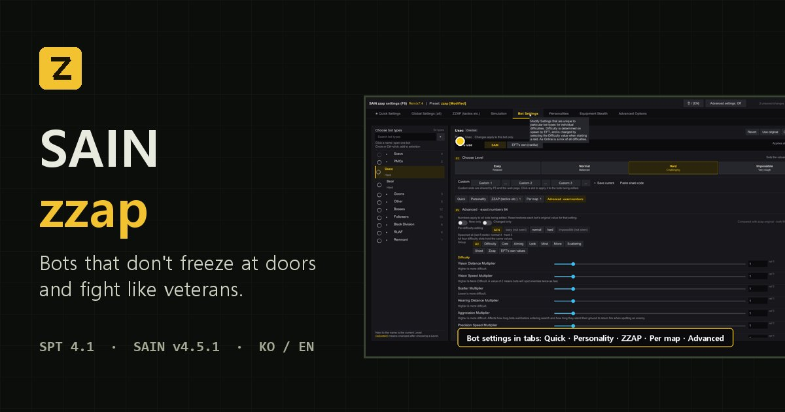

  
  

  

<h2 align="center">📖 <a href="https://danyhappy564-cmyk.github.io/SAIN-zzap--Bootleg-/">설명은 전부 소개 사이트에 있습니다 →</a></h2>

전술 · 문 끼임 수정 · 설정 화면 · 프리셋 · 같이 쓰는 모드 · 제보 방법을 GIF와 함께 한 페이지에 정리했습니다.

  
  

---

### ⚠️ IMPORTANT NOTICE / DISCLAIMER

- **Original Author:** Solarint
- **Original Repository:** SAIN - Solarint's AI Modifications
- **Original Link:** https://github.com/Solarint/SAIN
- **License:** See upstream repository
- **This Port By:** R_F (danyhappy564-cmyk) — unofficial, AI-assisted port. Not affiliated with or endorsed by the original author.

1. **Reflection & Take-Downs:** I deeply reflect on the ECOT incident. As an AI-assisted "vibe coder," I will immediately delete files if the original authors ask.
2. **No Re-Distribution:** These ported builds are unverified, temporary fixes. Please do NOT re-upload or share them anywhere else.
3. **Do Not Pester Original Authors:** Never report bugs or pester original modders regarding issues from my unofficial ports.
4. **Full Credit & Respect:** I will always credit original creators on GitHub and prioritize their decisions above all else.
5. **Support Original Creators:** Instead of using my ports, please visit the original authors' Forge pages to leave kind words or tips.

---

## 변경 이력

전체 변경 이력 258개는 [`changelog/`](changelog/) 폴더에 10개씩 나눠 있습니다 (번호가 클수록 최신, 최신 파일: [`CHANGELOG-026.md`](changelog/CHANGELOG-026.md)). 릴리즈별 요약은 [Releases](../../releases).

## SAIN zzap

**원작자 · 원본 (저작권 표시)**
- **Solarint** — SAIN (Solarint's AI Modifications) · https://github.com/Solarint/SAIN
- 4.x 유지보수: **ArchangelWTF** · https://github.com/ArchangelWTF/SAIN
- 가져오거나 참고한 것:
  - **bmpq (tarkin)** — doordash · https://github.com/bmpq/spt-doordash · Forge https://sp-mod.com/mod/2214/doordash (MIT — Forge 모드 페이지 표기, 저장소에는 라이선스 파일 없음)
  - **maschine34675** — DualSideDoorBreach 2.0.2 · https://github.com/maschine34675/DualSideDoorBreach (MIT, Copyright (c) 2026 maschine34675)
  - **Chazut** — ORBIT · https://github.com/Chazut/ORBIT (MIT) — 문 끼임 대응 3가지(문 상태 워치독, 문 근처 감속 0.25배, 수평 위치로 정지 감지)를 ORBIT 코드를 보고 SAIN 구조에 맞게 다시 짜서 넣었고, 그 뒤 게임에서 나온 문제에 맞춰 고쳐 씀(워치독 1.2초·맵 전체 문 감시, 급한 이동은 닫힌 문만 1.5m부터 감속 등 — 자세한 경과와 지금 상태는 [`changelog/FIXES.md` 16번](changelog/FIXES.md)). zzap 프리셋의 성격 분포·탈출 설정은 ORBIT 권장값
  - **harmony** — TwitchPlayers · https://github.com/harmonyzt/TwitchPlayers · Forge https://sp-mod.com/mod/1895/sain-twitch-players (MIT — Forge 모드 페이지 표기, 저장소에는 라이선스 파일 없음) — zzap 프리셋의 사격·조준·반응 값은 TwitchPlayers(하드코어) 프리셋 값

SAIN(EFT 봇 AI를 통째로 바꾸는 모드)의 비공식 포크입니다. ① 봇이 **문 앞에서 끼는 버그**를 고치고, ② 고인물 플레이를 흉내 낸 **전술 행동**을 더하고, ③ 바로 쓰는 **zzap 프리셋**을 넣었습니다.

**SPT 4.1** · 상류 **SAIN v4.5.1** 기준 · 필수 모드 **BigBrain**, **Waypoints**

## 설치 / 업데이트

[릴리즈](../../releases/latest)의 `SAIN.REMIX.<버전>.7z` 하나에 클라 모드(`BepInEx`)와 서버 모드(`SPT_Runtime`)가 같이 들어 있습니다.

**바로 전 판에서 올리기:** 새 7z를 SPT 폴더에 덮어쓰기만 하면 됩니다. 설정·프리셋·내 설정 슬롯은 그대로입니다. 더 예전 판이면 아래 새로 설치를 권장합니다.

**새로 설치 (권장):**
1. 직접 만든 프리셋이 있으면 그 파일만 따로 복사해 둡니다(`SPT_Runtime/user/mods/Solarint-SAIN-ServerMod/Presets/`). 이름에 `[Modified]`가 붙은 파일과 내 설정 슬롯 `ClientData/botSettingsSlots.json`도 챙깁니다.
2. 이전 SAIN(원본이든 이 포크든) 두 폴더를 통째로 지웁니다: `BepInEx/plugins/SAIN/`, `SPT_Runtime/user/mods/Solarint-SAIN-ServerMod/`
3. **`BepInEx/config/SAIN-zzap/`는 지우지 마세요** — 플레이어 적응·학습 기록이 들어 있습니다.
4. 새 7z를 SPT 폴더(`EscapeFromTarkov.exe`가 있는 곳)에 풀고, 1번에서 챙긴 파일을 다시 넣습니다.
5. 처음 실행하면 `zzap` 프리셋이 한 번 자동으로 선택됩니다. 그다음부터는 F6에서 고른 프리셋이 유지됩니다.

## 버그·렉 제보

`BepInEx/LogOutput.log`를 꼭 같이 보내 주세요. 레이드 일지·진단 로그·장면 표시(F8)를 켜는 법은 [사이트의 제보 절](https://danyhappy564-cmyk.github.io/SAIN-zzap--Bootleg-/#report)에 있습니다.
**이 포크의 문제는 원작자(Solarint / ArchangelWTF)에게 제보하지 마세요.**

## 더 보기

- [소개 사이트](https://danyhappy564-cmyk.github.io/SAIN-zzap--Bootleg-/) — [전술](https://danyhappy564-cmyk.github.io/SAIN-zzap--Bootleg-/#tactics) · [문 수정](https://danyhappy564-cmyk.github.io/SAIN-zzap--Bootleg-/#doors) · [설정 화면](https://danyhappy564-cmyk.github.io/SAIN-zzap--Bootleg-/#settings) · [프리셋](https://danyhappy564-cmyk.github.io/SAIN-zzap--Bootleg-/#presets) · [같이 쓰는 모드](https://danyhappy564-cmyk.github.io/SAIN-zzap--Bootleg-/#compat)
- [릴리즈 노트](../../releases) — 버전별 바뀐 점
- [상세 문서](docs/DETAILS.md) — 기능 표·시뮬레이션 랩·빌드 방법 등 예전 README 전체
- [문 끼임 수정 상세](changelog/FIXES.md)

## 라이선스

원작 Solarint의 라이선스를 따릅니다.
봇 몸통박치기(`SAIN/Classes/Bot/Doors/BotDoorBreacher.cs`)에는 doordash(bmpq, MIT)와 DualSideDoorBreach(maschine34675, MIT — Copyright (c) 2026 maschine34675)의 코드가,
문 처리(`DoorOpener.cs`·`BotPathData.cs`)에는 ORBIT(Chazut, MIT)을 본뜬 코드가, zzap 프리셋에는 TwitchPlayers(harmony, MIT)의 값이 들어 있습니다.
허가 문구 전문과 출처는 [`THIRD_PARTY_NOTICES.md`](THIRD_PARTY_NOTICES.md)에 있습니다.
