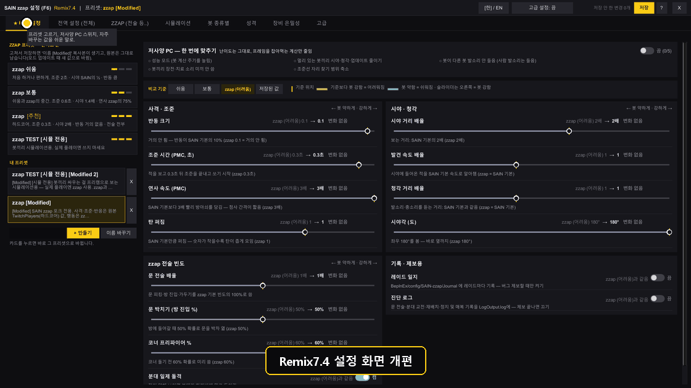
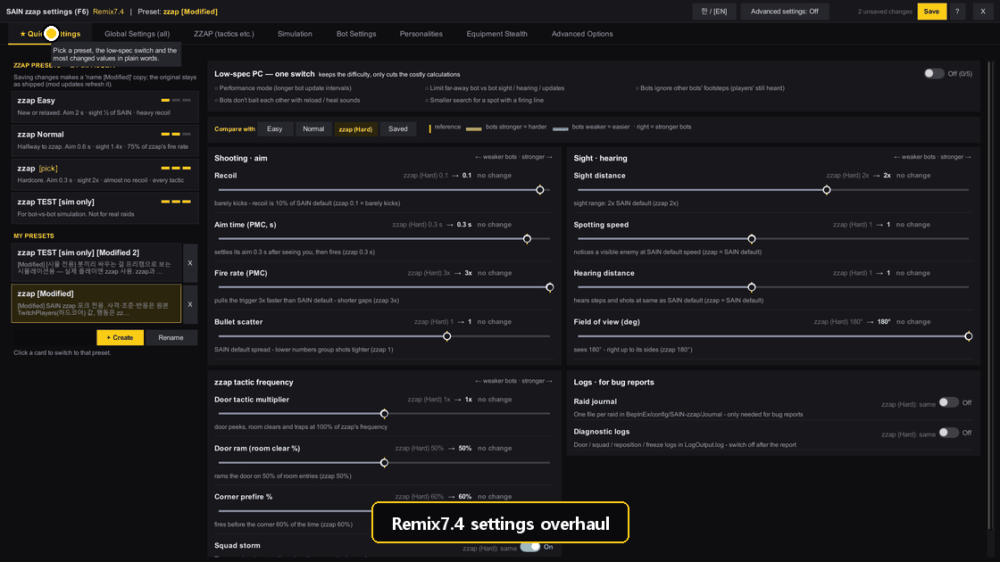

# SAIN-zzap--Bootleg- Remix7.4

**태그:** `remix7.4` (master — 태그는 이 노트가 들어간 master 최신 커밋에)

**원작:**

1. **Solarint** — SAIN (Solarint's AI Modifications)
   - Repository: [Solarint/SAIN](https://github.com/Solarint/SAIN)
   - License: 원본 저장소 참고
2. **ArchangelWTF** — SAIN 4.x 유지보수판 (이 포크의 기준 v4.5.1, SPT 4.1)
   - Repository: [ArchangelWTF/SAIN](https://github.com/ArchangelWTF/SAIN)
   - License: 원본 저장소 참고
3. **bmpq (tarkin)** — doordash (봇 몸통박치기 코드를 봇 전용으로 이식)
   - Repository: [bmpq/spt-doordash](https://github.com/bmpq/spt-doordash)
   - License: 라이선스 파일 없음
4. **maschine34675** — DualSideDoorBreach 2.0.2 (문 양쪽 박치기 방식 이식)
   - Repository: [maschine34675/DualSideDoorBreach](https://github.com/maschine34675/DualSideDoorBreach)
   - License: MIT, Copyright (c) 2026 maschine34675

**이전 릴리즈:** Remix7.3 (GitHub 릴리즈 `remix7.3`, 11/03 게시) → **이번: Remix7.4** (설정 화면 정리 + 봇 종류별 ZZAP·맵별 설정)

> F6와 웹의 설정 화면을 더 쉽게 정리한 판입니다. zzap 전술을 **쉬운 말 스위치**로 켜고 끄고, **봇 종류마다** 전술을 따로 켜고 끄거나 **맵마다** 청각·시야 같은 수치를 따로 줄 수 있습니다.
> 봇 행동(전투 방식)과 zzap 프리셋 값은 Remix7.3과 같습니다. 이전에 맞춰 둔 프리셋은 그대로 쓰면 되고, 새 칸은 모두 '전역 따름'·'1배'로 시작해서 **업데이트만 해서는 아무것도 달라지지 않습니다.**

---

**<설치 / 업데이트>**

- **Remix7.3에서 올라오는 경우:** `SAIN.REMIX.7.4.7z`를 풀어서 SPT 폴더(`EscapeFromTarkov.exe`가 있는 곳)에 덮어써 주세요. 클라이언트(`BepInEx`)와 서버 모드(`SPT_Runtime`)가 같이 들어 있고, **이번에는 둘 다 바뀌었습니다**. 설정·프리셋·내 설정 슬롯은 그대로입니다.
- **Remix7.3보다 전 판에서 올라오는 경우:** 그 판 이후 노트의 설치 순서대로 한 뒤 위처럼 덮어써 주세요. 지우고 새로 설치할 때는 `Presets/` 안의 **이름에 `[Modified]`가 붙은 파일과 직접 만든 프리셋**, `ClientData/botSettingsSlots.json`(내 설정 슬롯)을 먼저 따로 복사해 두세요.

---

**<변경점>**

**1. 영어 화면에서 프리셋 이름도 영어로**
- 영어 화면에서도 기본 프리셋 이름이 'zzap 쉬움'·'zzap 보통'처럼 한글로 보이던 것을 'zzap Easy'·'zzap Normal'·'zzap TEST [sim only]'로 보이게 했습니다. 한국어 화면은 그대로입니다.
- **파일 이름은 바꾸지 않고 보이는 이름만 바꿨습니다.** 그래서 이전에 고른 프리셋과 `[Modified]` 사본(예: 'zzap 보통 [Modified]' → 영어 화면에서 'zzap Normal [Modified]')이 그대로 이어집니다.

**2. 비교 기준 순서 · 내 프리셋 이름 바꾸기**
- 비교 기준 버튼을 **쉬움 / 보통 / zzap (어려움) / 저장된 값** 순서로 맞췄습니다(F6·웹 같음). 웹에서 시뮬 전용 TEST 프리셋은 비교 기준에서 뺐습니다.
- 직접 만든 프리셋 이름을 바꿀 수 있습니다. F6는 빠른 설정 왼쪽 아래 **[이름 바꾸기]**(지금 쓰는 프리셋을 칸에 적은 이름으로), 웹은 내 프리셋 카드의 **연필 아이콘**입니다. 게임이 그 프리셋을 쓰고 있으면 새 이름으로 따라가고, 레이드 중이면 레이드가 끝난 뒤 바뀝니다. 기본 zzap 프리셋은 이름을 바꿀 수 없습니다. 저장 안 한 변경이 있으면 먼저 저장하거나 되돌려 달라고 알려 줍니다.

**3. 새 탭: 'ZZAP (전술 등..)' · '시뮬레이션'**
- '전역 설정 (전체)'에 섞여 있던 zzap 전술 묶음(문 전술·정지 및 매복·분대 교전·근접 교전·위치 변경·플레이어 스타일 기록)을 **'ZZAP (전술 등..)'** 탭으로, 시뮬레이션 랩을 **'시뮬레이션'** 탭으로 옮겼습니다. 검색도 탭마다 따로 됩니다.
- ZZAP 탭은 **한눈에 켜고 끄기**부터 열립니다. 문 전술, 분대 교전, 위치 바꾸기, 다이아몬드 스텝, **QEQE 기울이기 사격**, 모서리 흔들기 피킹, 붙으면 엄폐 대신 싸우기, 모서리 추격, 탄 떨어지면 권총, 빠른 장전, 사람 같은 실수, 두려움, 내 플레이 스타일에 적응, 스캐브는 근접전 zzap 제외 — 14개를 쉬운 설명과 스위치로 켜고 끕니다. 세부 숫자는 왼쪽 각 묶음에 그대로 있습니다.
- 설정 값 자체는 전과 같은 자리에 저장되므로 프리셋 파일 모양은 바뀌지 않습니다.

**4. 봇 설정을 탭으로: 빠른 설정 · 성격 · ZZAP · 맵별 보정 · 고급**
- 한 화면에 몰려 있던 봇 종류별 설정을 탭 5개로 나눴습니다(F6·웹 같음).
- **성격** 탭에서 그 봇 종류의 성격을 바로 정합니다(지정 안 함 = 성격 확률대로 섞임).
- **고급**은 묶음(난이도·코어·조준·시야·판단·이동·사격·Zzap 등)을 골라 한 묶음씩 볼 수 있습니다. 전에는 고급에서 ZZAP 관련 값을 바꿀 수 없었는데, 이제 'Zzap' 묶음이 있습니다.

**5. 봇 종류마다 ZZAP 전술 따로 (ZZAP 탭)**
- 문 전술, 분대 교전, 위치 바꾸기, **근접전 zzap 행동 전체**, **다이아몬드 스텝**, **QEQE 기울이기 사격**, 모서리 흔들기 피킹을 봇 종류마다 **전역 따름 / 켬 / 끔**으로 고릅니다. 난이도 4칸 모두에 들어가고, 여러 봇을 묶어서 한 번에 바꿀 수도 있습니다.
- **켬**은 전역 스위치와 '스캐브는 근접전 zzap 제외'보다 우선합니다(예: 스캐브도 다이아몬드 스텝). 누가 다이아몬드 스텝을 하는지 같은 성격 규칙은 그대로입니다. **끔**은 그 봇 종류만 그 전술을 안 씁니다(예: PMC만 QEQE 끄기).
- 탭 이름 옆 숫자는 '전역 따름'이 아닌 스위치 개수입니다.

**6. 봇 종류마다 맵별 보정 (맵별 보정 탭)**
- 제보 받은 요청("연구소에서는 봇이 소리를 덜 듣게, 리저브는 그대로")을 넣었습니다. 봇 종류마다, 맵마다 **청각 거리·시야 거리·발견 속도·공격성·탄 퍼짐·정밀 조준 속도·조준 맞추는 시간**을 배수로 줍니다. 1.0 = 그대로.
- 전역 '맵별 보정'(모든 봇 공통) 위에 곱해집니다. 예: 전역 연구소 0.8배 × 이 봇 연구소 0.5배 = 0.4배. 화면에 그 맵의 전역 값도 같이 보입니다.
- 바꾼 맵에만 값이 저장되고 다른 맵은 그대로입니다. 레이드에 봇이 생길 때 적용되므로 **다음 레이드부터** 반영됩니다.
- 이번 판은 숫자 보정만 넣었습니다. '이 맵에서만 게임 기본 AI(바닐라)'는 AI를 바꾸려면 게임을 다시 켜야 해서 따로 검토합니다.

**확인**
- 게임 F6와 크롬 웹 화면에서 한국어·영어로 직접 눌러 봤습니다: 영어 프리셋 이름, 비교 기준, 이름 바꾸기 버튼, ZZAP·시뮬레이션 탭과 한눈에 스위치, 봇 설정 탭 5개, 봇별 ZZAP 스위치, 맵별 보정 슬라이더, 고급 묶음 고르기. 이때 찾은 두 가지(바닐라 봇에서 ZZAP 탭 숫자가 7로 나옴, 손잡이 개수)를 고쳤습니다.
- 시험 프리셋으로 리저브 레이드를 돌려 게임 안 봇 값을 직접 읽었습니다: PMC에 'QEQE 끔·근접전 끔'을 넣으면 그 봇이 실제로 근접전 zzap을 건너뛰고, Usec에만 '리저브 청각 0.5배'를 넣으면 같은 판의 Usec은 0.5배·Bear는 1배였습니다. 그 판 게임 로그에 SAIN 오류 없음.
- 이전 판 프리셋을 그대로 읽으면 모두 '전역 따름'·'1배'로 전과 똑같이 동작하는 것을 자동 시험으로 확인했습니다(시험 54개·웹 53개 통과).

**알려진 점**
- **되돌리기**를 눌러도 위쪽 '저장 안 한 변경' 개수가 줄지 않습니다(Remix7.2부터 있던 동작). 저장하면 정상으로 돌아옵니다.
- 서버를 처음 켤 때 기존 프리셋 파일에 새 칸(전역 따름·빈 맵별 보정)이 붙어 다시 저장됩니다. 값은 기본값이라 동작은 같습니다.
- 문제가 있으면 스크린샷과 `BepInEx/LogOutput.log`를 보내 주세요. Remix7.3으로 되돌리려면 SAIN.REMIX.7.3.7z를 다시 덮어쓰면 됩니다(새 칸은 무시됩니다).

------------------------------------------------------------------------------------------------------------------------------------------------------

**<Changes (English)>**

**Previous release:** Remix7.3 (`remix7.3`, published 11/03) → **this: Remix7.4**, a cleaner settings screen plus ZZAP and per-map settings per bot type. Bot behaviour and zzap preset values are the same as Remix7.3. Your presets keep working: every new setting starts at Global / 1x, so **updating alone changes nothing**.

**Install / update:** extract `SAIN.REMIX.7.4.7z` into your SPT folder (where `EscapeFromTarkov.exe` is) and overwrite. It holds both the client (`BepInEx`) and the server mod (`SPT_Runtime`), and both changed this time. Settings, presets and custom slots are kept. On a clean install, keep your `[Modified]` and own preset files and `ClientData/botSettingsSlots.json` first.

**1. English preset names** - the English UI now shows the bundled presets as "zzap Easy", "zzap Normal" and "zzap TEST [sim only]" (they were shown in Korean). Only the shown name changed, not the file name, so your saved pick and `[Modified]` copies carry on ("zzap 보통 [Modified]" reads "zzap Normal [Modified]").

**2. Compare order and renaming your presets** - the Compare with buttons read **Easy / Normal / zzap (Hard) / Saved** in F6 and on the web (the sim-only TEST preset is no longer offered on the web). Your own presets can be renamed: **Rename** at the bottom left of F6 Quick Settings (renames the current preset to the name in the box), or the **pencil** on a preset card on the web. A game using that preset follows the new name (after the raid if one is running). Bundled zzap presets can't be renamed; with unsaved changes you are asked to save or revert first.

**3. New tabs: "ZZAP (tactics etc.)" and "Simulation"** - the zzap sections that sat inside Global settings (door tactics, freeze ambush, squad combat, close combat, reposition, player style recorder) moved to **ZZAP (tactics etc.)**, and the Simulation Lab to **Simulation**; each tab searches its own settings. The ZZAP tab opens on **At a glance**: 14 tactics with a plain description and an on/off switch (door tactics, squad combat, reposition, diamond step, **QEQE lean shooting**, corner jiggle peek, fight close instead of cover, corner chase, pistol when empty, quick reload, human mistakes, fear, adapt to my play style, scavs skip close-combat zzap). The exact numbers stay in each section on the left, and the values are stored where they always were.

**4. Bot settings in tabs: Quick · Personality · ZZAP · Per map · Advanced** - the crowded bot type page is split into five tabs (F6 and web). **Personality** picks the personality for that bot type right there (Unassigned = mixed by chance). **Advanced** shows one group at a time and now includes a **Zzap** group - before, nothing ZZAP could be set per bot.

**5. ZZAP per bot type (ZZAP tab)** - door tactics, squad combat, reposition, **all close-combat zzap moves**, **diamond step**, **QEQE lean shooting** and corner jiggle peek can each be **Global / On / Off** per bot type (all four difficulty slots; works on a selection of bots too). **On** wins over the global switch and Skip Scavs (scavs can diamond-step too); personality rules such as who diamond-steps stay. **Off** turns that tactic off for that bot type only (e.g. no QEQE for PMCs). The number next to the tab name counts switches not on Global.

**6. Per-map multipliers per bot type (Per map tab)** - from a player request ("bots on Labs should hear less, Reserve stays default"): per bot type and per map, set **hearing distance, vision distance, spotting speed, aggression, scatter, precision speed and aim time** as multipliers (1.0 = unchanged). They multiply the global per-map modifiers (e.g. global Labs 0.8x × this bot on Labs 0.5x = 0.4x); the global value for that map is shown next to each row. Only changed maps are stored. Applied when a bot spawns, so from the **next raid**. This release has the numbers only; "vanilla AI on this map only" needs a game restart to switch AI, so it is being looked at separately.

**Checked** - clicked through in game (F6) and in Chrome (web), in Korean and English: English preset names, compare order, rename, ZZAP and Simulation tabs with the at-a-glance switches, the five bot settings tabs, per-bot ZZAP switches, per-map sliders, advanced groups; two things found there were fixed (ZZAP tab count showed 7 on a vanilla bot, knob count). A Reserve test raid with a test preset read the in-game bot values directly: with QEQE and close-combat Off for PMCs the bot really skips the close-combat zzap moves, and with Reserve hearing 0.5x on Usec only, that raid's Usec had 0.5x and Bear 1x. No SAIN errors in that raid's game log. Loading presets from before this release gives Global / 1x everywhere and the same play (automated tests: 54 + 53 web passed).

**Known issues** - **Undo** does not lower the "unsaved changes" count (since Remix7.2); saving clears it. On the first server start the existing preset files are saved again with the new entries (Global, empty per-map); values are defaults, so play is the same. Send a screenshot and `BepInEx/LogOutput.log` if anything is off. To go back, overwrite with SAIN.REMIX.7.3.7z (the new entries are ignored).

------------------------------------------------------------------------------------------------------------------------------------------------------

**!!!!!!!!!!!PLEASE READ THIS!!!!!!!!!!!**

Hi everyone,

I'd like to share a few thoughts and important warnings regarding the process of porting mods from version 4.0 to 4.1.

Following the recent "ECOT" mod incident, I've had a lot of time to reflect on my actions.
I’m not here to lecture anyone—I’m writing this simply in the hope that you’ll keep these points in mind.

**1. I am not a professional programmer; I am mostly a "vibe coder" who relies heavily on AI.**

By that, I mean I’m not someone who spends days designing and painstakingly crafting mods by hand from scratch.
At the same time, having tinkered with simple mod edits back in the TS/JS (SPT 2.3.1) days, I know firsthand how much time, effort, and care goes into this process.
Therefore, even if a mod is covered under an MIT License, if the original author requests that I delete the source code and stop distribution, I will willingly comply.

**2. Please DO NOT re-distribute or re-upload these modified mods to 3rd/4th party places.**

Even if my ported version has some fixes or improvements, please do not treat it as a long-term solution. Unlike official releases on "THE FORGE," I do not perform thorough debugging or full security scans.
Furthermore, imagine how disruptive it would be if someone mistook my ported build for an "official release" and pestered the original author about bugs in my version. It would be terrible.
Moving forward, I intend to approach any porting work with the utmost respect for original modders.
If I had spent days pouring my heart into making a mod, only to have someone take my code and modify it however they pleased, I wouldn't feel good about it either.
Therefore, when writing README.md files on GitHub, I will always credit the original creators, and if it's not a mod I built from scratch, I will fully respect the original modder's decisions and opinions.

**3. Please respect the original creators.**

If people ignore warning 2. and act as if my port is the "real deal," I would feel immense guilt.
Please do not do that. As the saying goes, "When in Rome, do as the Romans do"—and showing proper respect and courtesy is essential.
Instead, please visit the original creators' comment sections on The Forge to leave warm words of appreciation, encouragement, or even buy them a coffee/leave a tip if you can

**Thank you for reading this long post.**
**Stay safe and stay happy!**

**^^7**

------------------------------------------------------------------------------------------------------------------------------------------------------

**!!!!!!!!!!!꼭 읽어주세요!!!!!!!!!!**

안녕하세요 여러분

4.0 -> 4.1로 포팅하는 과정에 대해 드릴 말씀과 주의사항을 전달하고자 합니다.

이번 "ECOT" 모드 사건 이후로, 많은 반성의 계기를 가지게 되었습니다

뭔가, 설교를 드리는게 아니라 참고 해주셨으면 하는 마음에 글을 작성합니다.

**1. 저는 전문 프로그래머가 아니고, AI를 주로 이용하는 바이브코더입니다.**

해당말의 뜻은, 저는 매일 구상하고 힘들게 한땀한땀 손으로 모드를 만드는 사람이 아니고

또한, TS/JS (SPT 2.3.1) 시절에 간단하게 모드 수정을 거치며 이 과정이 얼마나 노력을 들이고, 시간이 필요한지 잘 알고 있습니다.

그렇기에, 해당 모드를 수정하면서 아무리 MIT 라이선스를 받았더라도 원 모드 제작자가 소스코드 삭제 및 배포를 중단해달라고 하면 중단할 의향이있습니다.

**2. 무단으로 수정한 모드를 "3차 4차 배포하지 마십쇼"**

제가 만든 버전이 개선점이 있어도, 오래 사용하지 마세요 저는 "FORGE" 에 올린 것 처럼 바이러스 검사나 디버깅을 완벽하게 수행하지 않습니다.

또한, 제가 포팅한 버전을 "진짜 릴리즈된 버전" 이라고 생각하고, 제 포팅 모드를 들고 원작자에게 가면 얼마나 민폐일까요? 끔찍합니다

저는 모더들을 최대한 존중하는 방향으로 포팅할 계획입니다.

아마, 제가 모드를 제작할 때 하루를 갈아넣어 만들었는데 누군가가 멋대로 코드를 뺏겨 지 멋대로 작성했다면 기분을 썩 좋지않을 것 같습니다.

고로 GITHUB에 README.MD 작성 시, 원작자 표기 및 제가 실제로 제작하지 않은 모드라면 최대한 해당 모드를 제작한 모더의 의견을 존중하는 방향으로 나아갈 것입니다.

**3. 원작자를 존중해주세요**

만일 2번 주의사항을 어겼을 시, 제가 포팅한 모드가 "진짜 모드다!" 이런 느낌이면 진짜 죄책감에 휩싸일 것 같습니다.

그런 짓은 하지말아주고, 로마에 왔으면 로마법을 지키듯이 한국에서는 예의를 갖추는 것이 미덕입니다.

해당 모드 제작자의 FORGE COMMENT 창에 들어가 따뜻한 위로와 감사하다는 격려 또는 그들에게 TIP을 건네주세요

**긴 글 읽어주셔서 감사합니다.** 

**행복하세요! ^^7**
